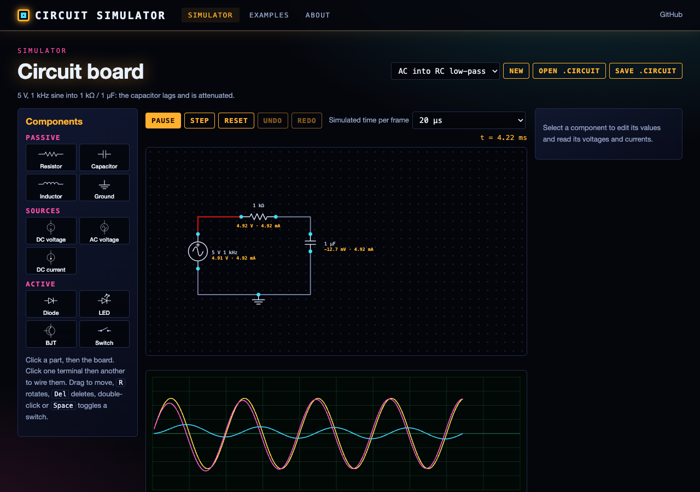
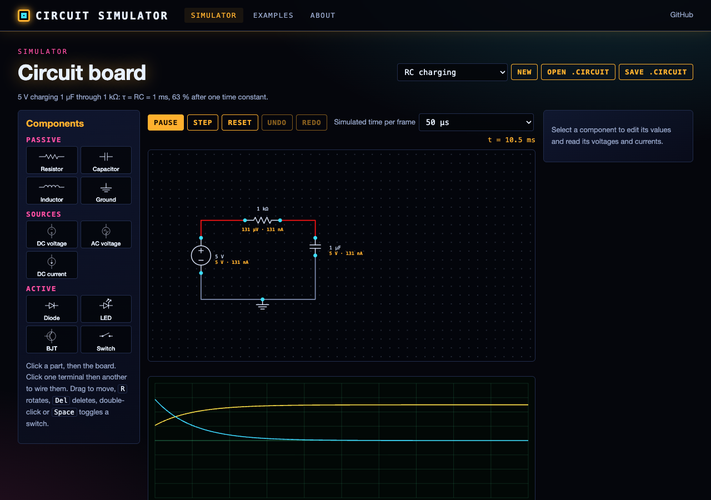
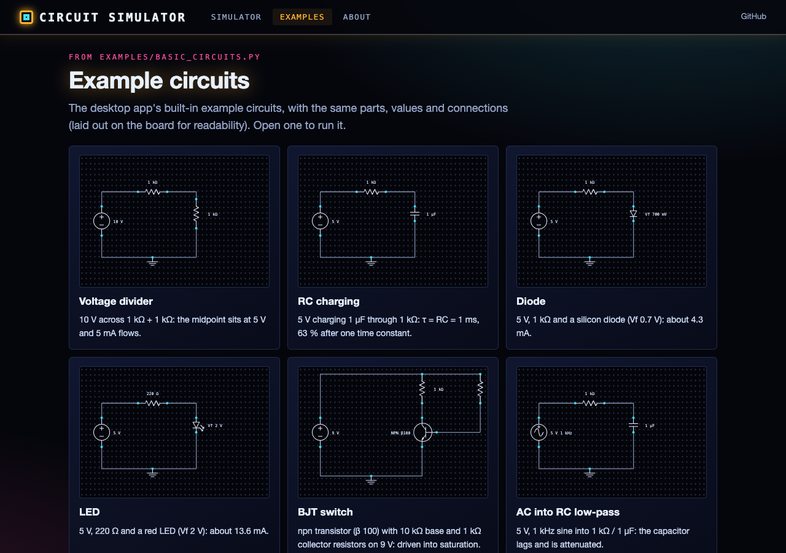

# Circuit Simulator

An interactive electronic circuit simulator built with Python and PyQt5. Place components on a grid-based circuit board, wire them together, and run real-time simulations with visual feedback, automatic schematic generation, and measurement tools.

## Features

### Interactive Circuit Board
- Grid-based component placement with snap-to-grid
- Click-and-drag wiring between connection points
- Zoom (0.5x--2.0x) and pan controls
- Component selection, rotation, and deletion
- Multiple board modes for placing, wiring, and selecting

### Real-Time Simulation
- Modified Nodal Analysis (MNA) circuit solver (`simulation/mna.py`, `simulation/transient.py`): trapezoidal
  capacitor/inductor models in sub-steps of at most 10 µs inside each frame (backward-Euler steps right after a
  switch flip or other sudden change, so nothing rings), piecewise-linear diodes, LEDs and BJTs
- Parts driven past their rating (max power, voltage or current) are framed in red with the reason; the solution is
  never clamped
- Configurable frame timestep (default 1ms of simulated time per update)
- Live voltage and current visualization with color-coded feedback
- 30 FPS simulation update loop

### Automatic Schematic Diagram
- Auto-generated circuit schematic view alongside the board layout

### Analysis Tools
- Built-in analysis panel for measurements
- Debug console for simulation events and logging

### Component Library
- **Passive**: Resistors (1k default), Capacitors (1uF), Inductors (1mH), Ground
- **Active**: Diodes, LEDs, BJTs, Switches
- **Sources**: DC Voltage (5V), AC Voltage (5V, 1kHz), DC Current (10mA)
- **Meters**: Voltmeter, Ammeter, Oscilloscope and Multimeter classes are defined in `components/meters.py` but cannot
  yet be placed on the board (the board and file loader create only the components listed above)
- All components stored in an SQLite database with configurable default properties

### File Operations
- Save and load circuit designs (JSON format)
- Example circuits included
- User configuration stored in `~/.circuit_simulator/`

## Project Structure

```
circuit_simulator/
  main.py                  # Entry point: argument parsing, app initialization
  config.py                # Configuration: paths, simulation params, GUI settings, colors, defaults
  requirements.txt         # Python dependencies
  components/              # Component definitions
    base_component.py      # Abstract base class (connections, state, properties)
    passive_components.py  # Resistor, Capacitor, Inductor, Ground
    active_components.py   # DC/AC voltage and DC current sources, Diode, LED, BJT, Switch (used by the app)
    sources.py             # Alternative source classes (not used by the board)
    meters.py              # Voltmeter, Ammeter
    wires.py               # Wire connections
  simulation/              # Simulation engine
    simulator.py           # CircuitSimulator: node management, event system
    circuit_solver.py      # CircuitSolver: binds the MNA engine to the simulator
    mna.py                 # Modified Nodal Analysis engine (Qt-free)
    transient.py           # Time stepping + per-component readouts
    physics.py             # Component physics models
    analysis.py            # Circuit analysis utilities
  gui/                     # User interface
    main_window.py         # Main window: menus, toolbars, layout, simulation timer
    circuit_board.py       # Interactive circuit board widget
    circuit_diagram.py     # Auto-generated schematic view
    component_panel.py     # Component selection panel
    analysis_panel.py      # Measurement and analysis display
    debug_console.py       # Debug/logging console
    resources/             # Icons and UI assets
  database/                # Data persistence
    db_manager.py          # SQLite database manager
    models.py              # Database models
    schema.sql             # Database schema definition
  utils/                   # Utilities
    circuit_parser.py      # Circuit file parsing
    file_manager.py        # Save/load file operations
    logger.py              # Logging setup and simulation event tracking
  examples/                # Example circuits
    basic_circuits.py      # Programmatic example circuit definitions
    saved_circuits/        # Saved circuit JSON files
```

## Requirements

- Python 3.7+
- PyQt5 >= 5.15.0
- NumPy >= 1.19.0
- SciPy >= 1.5.0
- Matplotlib >= 3.3.0

## Installation

```bash
pip install -r requirements.txt
```

## Usage

```bash
python main.py
```

### Command-Line Options

| Flag | Description |
|------|-------------|
| `--debug` | Enable debug mode (verbose logging) |
| `--load <file>` | Load a saved circuit file on startup |
| `--example <name>` | Load a built-in example circuit |
| `--config <file>` | Path to a custom JSON configuration file |

### Getting Started

1. Launch the application
2. Select a component from the component panel on the left
3. Click on the circuit board to place it; right-click or use toolbar to rotate
4. Switch to wiring mode and click-drag between connection points to wire components
5. Open the Simulation menu and start the simulation
6. View live voltage/current in the analysis panel; check the debug console for events

### Configuration

Default settings are stored in `~/.circuit_simulator/config.json` and can be overridden with `--config`. Key parameters:

- **Simulation**: timestep (1ms), max steps (10000), convergence (1e-6), max iterations (100)
- **GUI**: grid size (20px), component size (60px), wire thickness (2px)
- **Colors**: background, grid, wire, selection, voltage high/low, current

## Web interface

The same simulator runs in the browser: <https://gddickinson.github.io/circuit_simulator/> (GitHub Pages, no server
needed). Draw a schematic on the grid (place, drag, rotate, delete, wire terminal to terminal), edit values with SI
units (`4.7k`, `10u`, `2.2 MΩ`, `500 mA`), undo/redo (Ctrl/⌘+Z), press Run and read live voltages and currents on
every part, with wires coloured by node voltage, over-rated parts flagged, and an oscilloscope plotting up to four
probes. The seven example circuits of
`examples/basic_circuits.py` are included, and circuits save to and open from the desktop app's `.circuit` format.





The engine in the browser (`web/static/circuit_engine.js`, `transient_engine.js`) is a port of `simulation/mna.py` and
`simulation/transient.py`; a node test replays fourteen circuits and matches every terminal voltage and current of the
Python engine to 1 part in 10^9 (in practice ~1e-13).

### Run the web app

```bash
pip install -r requirements-web.txt
python run_web.py            # http://127.0.0.1:8234 ; adds a "Check vs Python" button on the simulator page
python -m pytest -q tests    # solver, file format, fixture and web tests (needs node for the JS engine test)
python scripts/build_static.py --out site   # the static site that .github/workflows/pages.yml publishes
```

## License

This project is open-source and available under the MIT License.


---
*Built with AI assistance from [Claude (Anthropic)](https://claude.com/).*
